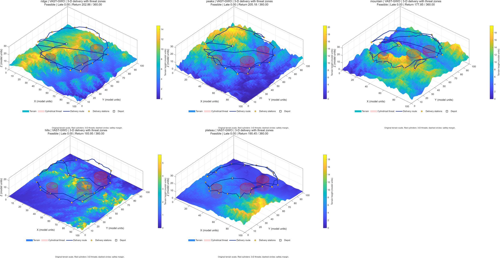

# VAST-GWO：已验证精英档案引导的稀疏评价灰狼优化算法

**中文初稿 v1（工作稿）**
状态说明：本文数字全部来自本仓库实验记录（`sparse_q/reports/EXPERIMENT_REPORT_zh.md`、
`sparse_q/experiments/registry.csv`、各批次 `results/*/runs.csv`），可按批次号追溯；
应用章节（三维无人机路径规划）已完成：第 6 章（900/900 次正式实验，含截尾统计修订）。
**英文正式稿 v1 已完成**：`文章\VAST-GWO_EN\main.tex`（IEEEtran，8 页，27 条参考文献，含框架图/排名图/来源归因图/应用三图；仓库镜像 `sparse_q/paper/en_manuscript_v1/`）。

---

## 摘要

灰狼优化算法（GWO）在有限真实适应度评价预算下容易出现两个问题：其一，每代对全部候选
逐一评价会造成预算浪费；其二，领导信息驱动的候选生成方式单一，搜索容易过早聚集。
本文提出 **VAST-GWO（Verified Archive-guided Sparse-evaluation Technique for Grey Wolf
Optimization）**：每代廉价生成 M=100 个候选，仅对其中的 K=10 个进行**真实评价**，且未经
真实评价的候选绝不参与领导更新、档案维护与任何排序。候选来自三条互补路线：G1 标准 GWO
领导移动（50 个）、G2 基于历史成功步长的 α 壳（12 个）、E 由**已验证精英档案**生成的多
区域壳与双中心线段（38 个）。在 CEC2017、D=50、29 函数 × 30 种子 × 100,000 真实评价的
统一协议下，VAST-GWO 在与 GWO、I-GWO、HAGWO（2026）、PSO、CLPSO 等七种算法的比较中
平均排名第一（2.24）；对 GWO 为 28 胜 1 负（Holm 校正 +24/−0）；对 2026 年公开源码的
HAGWO 为 22 胜 7 负（+19/−3）。消融实验给出了清晰的机制归因：关闭 G2/E 后（仅 GWO 候选
+ 稀疏评价）性能大幅下降（27 胜 2 负、+23/−0）；把 E 替换为 α 单中心采样后全面崩坏
（2 胜 27 负、+2/−23）——**已验证的多区域档案是主要性能来源**；而 G2 在 E 存在时边际
贡献接近于零（完整版 vs G1+E：14–15，池化 p=0.326）。本文同时如实报告若干负结果：
Q-learning 与定向筛选调度未超过最佳固定策略；成功方向引导的收益在随机方向对照下无法
区分于"额外扰动"。D=100 与 20k 真实评价的低预算层级上 VAST-GWO 仍排名第一。

**关键词**：灰狼优化；稀疏评价；精英档案；多区域搜索；有限评价预算；CEC2017

---

## 1 引言

群智能算法依赖大量适应度评价，而在工程问题中真实评价往往昂贵（仿真、实验、黑箱系统）。
以灰狼优化算法（GWO，Mirjalili 等，2014）为例：经典 GWO 每代更新全部 ω 狼并逐一评价，
在总预算有限时，大量评价消耗于与搜索毫无交互的中间过程；同时，领导狼（α/β/δ）单一驱
动的候选生成方式在复杂地形与高维问题中容易过早聚集。

近年提升 GWO 的路线主要有三类：改进领导者更新方程（如 I-GWO，2021）；引入强化学习或
动态多策略调度（如 RL-LGWO 2025、DMSGWO 2026）；以及精英引导/分层搜索（如 EDGWO 2025、
HAGWO 2026、AOGWO 2026）。这些工作普遍按"每代评价全部个体"或"固定迭代次数"设定预算，
较少把**真实评价次数本身**当作一等资源来设计候选池结构。

本文关注的核心问题是：**在严格计费的真实评价预算下，候选解的"来源结构"如何决定搜索
质量？** 我们提出 VAST-GWO，其设计遵循三条原则：

1. **候选生成与真实评价分离**：每代廉价生成 100 个候选，只随机抽取 K=10 个做真实评价；
2. **只有通过真实评价验证的信息才允许回流**：领导狼、精英档案与所有统计量仅由真实
   评价更新，未经评价的候选对算法状态零影响；
3. **候选来源互补且可消融**：GWO 移动（G1）、历史成功步长壳（G2）、已验证精英档案的
   多区域壳/线段（E）三条路线在等候选池规模、等评价数的受控条件下逐一检验。

在 CEC2017（D=50、29 函数、30 种子）上与 6 个基线（含 2026 年公开源码的 HAGWO、经典强
改进 I-GWO、标准 PSO 与 CLPSO）比较，VAST-GWO 平均排名第一；消融实验进一步证明 E 是
主要性能来源，G2 在 E 存在时边际贡献约为零。我们把这一"负结果"同样完整报告，并讨论其
对方法设计的含义。

本文贡献：

* 提出一个轻量、无代理模型、无额外学习器的稀疏真实评价框架（每代 K=10），并给出严格
  的真实评价计费协议与审计方法；
* 设计并验证"已验证精英档案"驱动的多区域候选生成机制（容量与分离阈值预注册）；
* 在统一协议下完成七算法主表、5 档候选来源受控消融（等 M、等 K、等预算）、双轴
  （探索效率 / 停滞恢复）检验、D=100 与 20k FE 资源层级验证；
* 如实报告 Q-learning、定向筛选、停滞半径放大、成功方向引导等负结果，并给出机理解释。

---

## 2 相关工作

**GWO 及其改进。** GWO 以 α/β/δ 三只领导狼的包围-攻击方程驱动搜索；I-GWO（Nadimi-
Shahraki 等，2021）通过精英反向学习与逐维更新提升精度；RL-LGWO（Maleki 等，2025）用
强化学习控制领导者更新；DMSGWO（2026）以动态分组与自适应扰动平衡探索/开发；EDGWO
（Zhang & Chen，2025）为领导狼设计全局/局部算子并按参数 A 动态切换；HAGWO（2026）将
狼群分为优/中/劣三层并采用分级对抗更新；AOGWO（2026）引入选择性反向学习。上述方法多
在"每代评价全体"或固定迭代预算下评估。本文的差异点在于：**真实评价是唯一被计费的资源，
候选生成与评价解耦，且验证信息以多区域档案形式跨代复用**。

**PSO 家族与跨算法对照。** 经典 PSO（Kennedy & Eberhart，1995；惯性权重：Shi &
Eberhart，1998）与 CLPSO（Liang 等，2006）代表两类不同学习机制（自身/全局最优 vs 逐维
示范综合学习），在主表中作为跨算法强对照，用于检验"稀疏评价候选池"是否只是在 GWO 家
族内有效。

**稀疏评价与低预算优化。** 常见做法包括代理模型、代理引导采样、Q-learning 调用预算
调度等。本文刻意不引入代理模型，而是固定每代真实评价数 K=10，让候选池的"来源结构"成为
唯一变量；这与"用更复杂的筛选/学习器提高评价分配效率"的路线形成对照——后者的负结果在
第 5.5 节如实报告。

**精英记忆与档案。** 档案/记忆机制在组合优化与多种群算法中已有使用（如面向离散问题的
ASE-CGWO）。本文的档案强调两点：(1) **只收录真实评价过的解**（"已验证"）；(2) 档案参与
**候选生成**（多区域壳与双中心线段），且其规模（24）、分离阈值（2% 对角线）与候选配额
（38/100）均在正式实验前预注册。

---

## 3 方法：VAST-GWO

### 3.1 总体框架

每一代执行：

1. **候选生成**（无真实评价）：从三条路线生成 M=100 个廉价候选；
2. **稀疏评价**：全池**均匀随机**抽取 K=10 个候选，逐一调用真实目标函数（每一次调用都
   计费；同一次运行内重复位置不重复评价）；
3. **提交与更新**：按候选来源应用不同的提交规则（见 3.3）；领导狼（α/β/δ）与精英档案
   **只由真实评价结果更新**；
4. 循环直至真实评价预算耗尽。

典型预算分解（D=50，100,000 FE）：初始化 50 次 + 9,995 代 × 10 次 = 100,000 次。
实现中由 `EvalProbe` 探针独立计数并断言实际调用次数与预算完全一致。

### 3.2 三路线候选池（M = G1 50 + G2 12 + E 38 = 100）

**G1：标准 GWO 领导移动（50 个）。** 对每只狼按经典 GWO 方程生成候选：
`x' = (X1+X2+X3)/3`，其中 `Xk = Xleader − A·|C·Xleader − x|`，A、C 逐维随机，收敛因子
`a` 随真实评价进度线性衰减（与标准 GWO 一致）。

**G2：α 成功步长壳（12 个）。** 以当前 α 为中心、在 `σ` 尺度的壳内采样：
`x' = α + σ(2r−1)`，其中 σ 取**最近 25 次成功步长**（真实评价中被接受为更优的位移范数）
的中位数，下限为搜索域对角线的 1%。该路线用于局部精化，其尺度由真实搜索历史自动确定。

**E：已验证精英档案的多区域壳/线段（38 个）。** 档案容量 24，插入条件为"真实评价改进"
且与最近档案解的距离 ≥ 2% 对角线；档案条目带 credit（被真实改进验证的次数）。
38 个候选按 19 + 19 构造：

* 19 个单中心壳：以 credit 加权选取档案中心 `c`，`x' = c + σ·(0.5+r)(2r−1)`；
* 19 个双中心线段：取两个档案中心 `c1, c2`，`x' = c1 + λ(c2−c1) + 0.25σ(2r−1)`，
  λ ~ U(0.15, 0.85)。

档案在多区域间维持分离性，使不同盆地/走廊的信息跨代保留。

### 3.3 稀疏评价、提交规则与"未评价不可见"原则

* **抽取**：K=10 个候选从 100 个槽位中均匀随机抽取（预注册为默认采样策略；替代策略见
  第 5.5 节负结果）。
* **提交**：G1 候选被抽中且优于其父狼时**原子提交**（更新父狼位置与适应度）；G2/E 候选
  被抽中且严格优于当前最差狼时替换之。
* **不可见原则**：未被真实评价的候选不参与领导排序、不进入档案、不更新任何统计量；
  α/β/δ 仅由真实评价刷新。
* **档案验证**：只有真实评价过的解可以进入档案；档案中心由此始终对应已知可行/已知适应
  度的位置。

### 3.4 复杂度与参数

每代仅生成 M 个候选（廉价运算）并执行 K 次真实评价；除 K 与三条路线的配额（预注册后
固定为 10、50/12/38）外无其他超参数。D=50、100k FE 单次运行平均 5.93 s（MATLAB，
同一机器，详见 5.6 节）。

---

## 4 实验设计

* **基准**：CEC2017 官方 MATLAB 包；使用 F1、F3–F30 共 29 个函数（官方包不含 F2）。
* **维度与预算**：D=50；每个算法每次运行 **100,000 次真实评价**（含初始化；以探针独立
  计数校验，全部批次 0 违规）。
* **种子与配对**：每函数 30 个种子（3001–3030）；同一（函数, 种子）下所有算法共享同一
  初始种群（初始化随机流与搜索随机流分离）。
* **并行**：MATLAB `parpool('local',4)`，恰好 4 个 worker；每个作业独立落盘、可断点续跑。
* **统计**：逐函数配对 Wilcoxon 检验 + Holm 多重校正；报告中位误差比（算法/基线）、函数
  胜-负、池化 p 与跨函数平均排名；显著性阈值 0.05。所有批次、单变量改动与失败配置记录在
  `experiments/registry.csv`。
* **对照算法（6 个）**：GWO、I-GWO、HAGWO（2026，作者 MATLAB 源码）、PSO（经典惯性版，
  w 0.9→0.4、c1=c2=2、vmax=0.2×range）、CLPSO（Liang 等 2006，按 TEC2006 原版代码严格
  复现）、（另见 5.1 脚注：为比较集完整性曾审计 RL-LGWO/DMSGWO/EDGWO，因复现或口径问题
  不进入主表，记录保留）。
* **运行环境**：MATLAB R2025b；同一机器完成全部实验；运行时间按"每次 100k FE"如实记录。

---

## 5 实验结果

### 5.1 主表：七算法对比（D=50，29 函数 × 30 种子，100k 真实评价）

| 算法 | 中位误差比\* | 函数胜-负 | Holm (+/−) | 池化 p | 平均排名 |
|---|---:|---:|---:|---:|---:|
| **VAST-GWO** | – | – | – | – | **2.24（第 1）** |
| I-GWO | 0.938 | 17-12 | +12/−6 | 0.55 | 2.28 |
| HAGWO (2026) | 0.806 | 22-7 | +19/−3 | 2.2e-36 | 3.41 |
| PSO | 0.652 | 23-6 | +19/−2 | 5.8e-31 | 4.41 |
| CLPSO† | 0.668 | 21-8 | +20/−5 | 7.4e-27 | 4.48 |
| AOGWO (2026) | 0.586 | 27-2 | +21/−0 | 1.3e-85 | 5.07 |
| GWO | 0.525 | 28-1 | +24/−0 | 6.7e-103 | 6.10 |

\*中位误差比 = VAST-GWO / 基线，小于 1 表示 VAST-GWO 更优；Holm 列为 VAST-GWO 相对该
基线的逐函数显著胜/负个数。

主要观察：

1. **对原始 GWO 的改进是决定性的**：28-1、Holm +24/−0（p≈1e-103）；
2. **对 2026 年公开源码的 HAGWO 显著占优**（22-7、+19/−3），说明"候选来源结构 + 稀疏
   评价"并非只在较弱基线上有效；
3. **对 I-GWO 的差距不显著**（17-12、+12/−6、池化 p=0.55）：主表能支持的主张是"在强
   PSO 与近期公开源码 GWO 面前保持第一排名（2.24 vs 2.28）"，不能宣称全面显著优于 I-GWO；
4. 跨算法对照（PSO/CLPSO）同样显著占优（+19/−2、+20/−5）。

†CLPSO 主表口径为冻结基准套件数据；已用 TEC2006 原版代码严格复现交叉验证（归档版 vs
严格复现版：中位比 1.017、9-20、Holm +1/−3、p=0.085，统计不可区分）。两种严格复现口径
（N=50 / 原论文 N=40）下"VAST-GWO 显著胜 CLPSO"结论不变（+19/−5、+17/−6）。

### 5.2 候选来源消融（等 M=100、等 K=10、等 100k FE，种子 3071–3100）

受控替换规则：关闭某路线时，其槽位由**标准 GWO 候选**填补（保持总候选数 100、真实评价
数 10/代、接受规则不变）；完整版（A3）与冻结实现逐位一致（审计通过）。

| 对比（逐函数 30 种子配对） | 中位比 | 胜-负 | Holm | 池化 p |
|---|---:|---:|---:|---:|
| A3 完整 vs A0 仅 GWO 候选 | 0.538 | 27-2 | +23/−0 | 7e-102 |
| A3 完整 vs A1（G1+G2） | 0.812 | 25-4 | +21/−1 | 5e-60 |
| A3 完整 vs A2（G1+E） | 0.994 | 14-15 | +1/−0 | 0.326 |
| A2（G1+E）vs A0 | 0.510 | 29-0 | +27/−0 | 7e-117 |
| A5（E→α 单中心）vs A3 | 1.407 | 2-27 | +2/−23 | 1e-64 |

**来源级真实改善统计**（每次运行被真实评价接受的人口改善次数）：E ≈ 24,068 ≫ G1 ≈ 11,325
≫ G2 ≈ 4,742；平均排名：A3 1.72 ≈ A2 1.79 < A5 3.34 < A1 3.52 < A0 4.62。

结论：

1. **"稀疏评价"本身不足**：仅 GWO 候选 + K=10 的 A0 大幅劣于完整池；
2. **已验证多区域档案是主要机制**：A2≈A3，且把 E 替换为 α 单中心（A5，槽位/尺度/接受
   规则全同）后全面崩坏；
3. **G2 在 E 存在时边际贡献≈0**（14-15、p=0.326；20% FE 检查点上 A2 甚至略优）——如实
   报告为中性/负结果，不夸大为"双路线协同"。

### 5.3 早期预算与探索/停滞双轴

* 对 GWO 的早期中位比：10% FE 0.802（25 胜）、20% FE 0.777（26 胜）、50% FE 0.726
  （27 胜）——优势在预算早期即建立；
* 探索效率轴（对 B0-ANGWO 基线）：20% FE 比值 0.768、简单多峰子集（F4–F10）0.714、
  有效新颖率 0.00640 vs 0.00578 → **通过**；
* 停滞恢复轴：恢复概率 0.8233 vs 0.7676（+0.0557，过门槛），长停滞占比 0.8133 vs
  0.8309（−0.0176，未达 −0.03 门槛）→ **部分通过**，如实报告。

### 5.4 跨维度与低预算验证

* **D=100**（29 函数 × 10 种子 × 100k FE，870/870 成功）：平均排名第一（1.72），
  对 I-GWO（12 函数公共子集）0.703（10-2、Holm +5/−1），对 RASE-GWO 0.836，对稠密同
  步基线 0.549；
* **20k FE 低预算**（29 函数 × 10 种子）：平均排名第一（1.97），对 GWO 0.721（24-5）、
  对 B0-ANGWO 0.807（24-5）。
* 说明稀疏评价框架的优势不是"100k × D50"单点现象。

### 5.5 负结果（完整保留）

1. **评价采样与调度**：几何/credit 定向筛选比均匀随机差（1.394、1.528）；固定探索配额
   高于池比例时有害（q75 1.672）；**Q-learning 三种变体均未超过最佳固定策略**
   （对固定 0.988–1.130；仅优于随机配额 0.75–0.87），动作分布诊断显示其奖励区分度不足。
2. **停滞半径放大**：boost3 为 1.204（更差）。
3. **坐标稀疏扰动（g2Subset=0.2）**：显著改善停滞指标（恢复 +0.072、长停滞 −0.068），
   但**最终误差未同步改善**（与 5.2 的 G2 边际≈0 一致）。
4. **成功方向引导（succSteer=0.5）**：在 fresh 30 种子上对冻结 V1 为 22-7（+2/−0），
   但**随机方向对照组与之统计不可区分**（中位比 0.988、Holm 3-5、p=0.155），且前 80%
   预算全程略差、仅末段反超，运行时间 +24%——因此**拒绝**将其作为独立机制，仅保留为
   "额外扰动"范畴的记录。

### 5.6 运行时间（每次 100k FE，同机 MATLAB）

| 算法 | 平均耗时 (s) |
|---|---:|
| VAST-GWO | 5.93 |
| PSO | 2.59 |
| CLPSO | 2.41（归档）/ 2.87（严格 N=50） |
| I-GWO | 2.32 |
| GWO | 3.63 |
| HAGWO | 3.41 |
| AOGWO | 4.54 |

VAST-GWO 在等 FE 下最慢（候选池生成 + 档案维护的代价），如实报告；该代价换来的是
5.1–5.4 的性能与鲁棒性。

---

## 6 应用：三维无人机配送路径规划（benchmark-v1）

### 6.1 场景与协议

应用场景基于五张真实地形（Copernicus GLO-90 DSM：山脊沟谷 ridge、多峰 peaks、山地
mountain、丘陵 hills、高原 plateau）构建三维无人机配送问题：每张地图 20 个配送站，
**硬时间窗**（五时间带、窗口宽约 140–172 时间单位），3 个圆柱威胁区；每航段 3 个中间
控制点（λ、横向/高度偏移），决策维度 **D = 20 + 3×21×3 = 209**。目标为三维航程、等待
与平滑度的加权惩罚，迟到、返仓超时、地形/障碍碰撞、净空、越界与角度超限作为约束。
**说明：这是基于真实 DEM 数据、经尺度归一化构造的仿真场景，不是实际飞行试验。**

协议（预注册，冻结）：所有算法 **N=50**、**30,000 次真实评价**（初始化计入，末态复算
单独记录）、同一（地图, 种子）共享初始种群、正式种子 **101–130**；MATLAB 恰好 4 worker，
逐作业原子落盘、可断点续跑。对比集：GWO、I-GWO、HAGWO(2026)、PSO、CLPSO 与 VAST-GWO
（VAST-GWO 使用与 CEC 章节逐参数一致的 50/12/38、K=10 配置）；共 **900/900 次运行成功，
0 失败**（约 7.5 小时）。

### 6.2 可靠性与效率（首次可行 FE 采用 30k 截尾口径）

| 算法 | 可行率 | RMST(FE) [95% CI] | 首次可行 FE 中位\* | 可行 Cost 中位 | 罚项中位† |
|---|---:|---|---:|---:|---:|
| **VAST-GWO** | **100.0%** | **7062 [6449, 7731]** | 6314 | 667.4 | 667.4 |
| HAGWO (2026) | 97.3% | 8133 [7355, 8950] | 7432 | 663.4 | 666.9 |
| PSO | 95.3% | 8138 [7058, 9324] | 5357 | 766.4 | 772.9 |
| I-GWO | 97.3% | 12270 [11374, 13179] | 11152 | 724.7 | 728.4 |
| GWO | 94.0% | 10936 [9941, 11983] | 8920 | 699.8 | 701.7 |
| CLPSO | 61.3% | 24427 [23312, 25383] | 21330 | 1015.4 | 1099.4 |

\*有条件口径（仅成功运行），仅作对照；†对全部运行取中位（含不可行罚项）。
**RMST = 30k 截尾下首次可行时间的限制均值，失败运行按 30k 计入——不剔除失败样本。**

累计可行率（%，同一次 30k 运行内的检查点；截尾仅发生在 30k）：

| 算法 | 2k | 5k | 10k | 20k | 30k |
|---|---:|---:|---:|---:|---:|
| **VAST-GWO** | 6.0 | 35.3 | **82.0** | **100.0** | **100.0** |
| HAGWO | 3.3 | 21.3 | 76.0 | 97.3 | 97.3 |
| PSO | **12.0** | **43.3** | 74.0 | 91.3 | 95.3 |
| GWO | 2.0 | 14.0 | 57.3 | 89.3 | 94.0 |
| I-GWO | 0.7 | 6.7 | 37.3 | 90.7 | 97.3 |
| CLPSO | 0.0 | 0.7 | 4.0 | 26.7 | 61.3 |

**VAST-GWO 是唯一在 150 次运行中全部找到可行路径的算法**（五张地图均为 100%），且在
截尾口径下 RMST 最小（7062 FE）；其可行率优势在中后段扩大（10k 时 82.0% vs 76.0%/74.0%；
20k 时 100% vs 97.3%/95.3%）。

### 6.3 配对统计（150 对 = 5 图 × 30 种子；Holm 跨 5 基线）

| 基线 | McNemar 可行性 | 可行 Cost 中位比 | Cost p (Holm) | rank-biserial | 截尾有序配对 p (Holm) |
|---|---:|---:|---:|---:|---:|
| GWO | **0.016** | 0.939 | **3.8e-4** | 0.36 | **2.8e-9** |
| I-GWO | 0.25 | 0.898 | **2.9e-12** | 0.68 | **3.2e-15** |
| HAGWO | 0.25 | 0.967 | **0.0458** | 0.19 | **0.0072** |
| PSO | **0.047** | 0.843 | **8.2e-20** | 0.89 | 0.598 |
| CLPSO | **3.5e-17** | 0.631 | **3.3e-16** | 1.00 | **4.4e-25** |

* 最终路径质量：**对全部 5 个基线的配对检验均显著更优**（中位比 0.631–0.967，Holm 后
  p 全部 ≤ 0.0458）；
* 可行性（McNemar）：显著优于 GWO、PSO、CLPSO；对 I-GWO/HAGWO 方向一致但配对差异数
  少（各 4 对）未达显著；
* 截尾有序配对（2k<5k<10k<20k<30k<未达成）：显著早于 GWO/I-GWO/HAGWO/CLPSO；对 PSO
  不显著（p=0.598，其早期更快、终值更差）；
* 分地图：VAST-GWO 在 5/5 张地图的可行 Cost 中位比上优于 GWO、PSO、CLPSO，4/5 优于
  I-GWO 与 HAGWO（ridge 与 HAGWO 打平/持平）。

### 6.4 VAST-GWO 在五张地图上的最优可行航迹

（上：ridge / peaks / mountain / hills / plateau；取 VAST-GWO 在每图的最优可行运行，
最终 Cost 481.7–600.7。颜色=地形高度；红色圆柱=三维威胁区（含安全裕度）；蓝线=配送
航迹；圆点=站点；方框=仓库。单图原图见 `results/uav_formal_N50_30k/figures/route_<map>.png`，
生成脚本 `app_uav3d/make_uav_routes.m`。）

### 6.5 如实说明

1. **PSO 早期可行更快**（2k 时 12% vs 6%；有条件首次可行中位 5357 vs 6314 FE），但其
   RMST（8138）与最终质量（766.4 vs 667.4）均劣于 VAST-GWO，且 7/150 次未找到可行解；
   截尾有序配对 p=0.598——两者的"到达可行"时间总体相当，差别在质量与可靠性。
2. **HAGWO 的边际中位 Cost（663.4）略低于 VAST-GWO（667.4）**：该数值按其自身成功运行
   计算；在双方均成功的 146 对上 VAST-GWO 显著更优（中位比 0.967、rb=0.19、Holm
   p=0.0458），且可行率更高（100% vs 97.3%）。论文同时报告两项口径，不择其一。
3. 2k–20k 均为 30k 协议内的检查点，**不等价于独立的短期预算运行**。
4. 图件：`results/uav_formal_N50_30k/figures/route_montage.png`（五图最优航迹，第 6.4 节）、
   `feasibility_curve.png`（累计可行率，
   主证据之一）、`rmst_bar.png`（RMST 与置信区间）、`final_cost_box.png`（可行 Cost
   箱线，与表中 `CkptBestFeasCost_5` 逐位一致）、`first_feasible_ecdf.png`（有条件补充图）。

## 7 讨论

**为什么"来源结构"比"评价调度"更重要？** 在不使用代理模型的严格计费协议下，每个候选
的真实适应度只能由一次真实评价获得；此时决定搜索质量的不是"如何聪明地挑 10 个候选"，
而是"这 10 个候选来自怎样的分布"。消融表明：把 88 个非 GWO 槽位还给 GWO 候选（A0）会
损失最大；E 一旦被 α 单中心替代（A5）就全面崩坏——**多区域、且只包含已验证解的档案**
提供了 GWO 移动与 α 局部壳都无法覆盖的候选区域。

**G2 的冗余与方法的进一步简化。** A2≈A3 与 20% FE 上 A2 略优说明：当 E 已经提供多区域
候选时，α 成功步长壳的边际价值≈0。本文保留冻结配置以维持预注册完整性，但该负结果本身
提示一个更简的"G1+E"变体值得在后续工作中单独验证。

**负结果的方法学含义。** Q-learning 调度、定向筛选、半径放大与方向引导四类"复杂化"都未
稳定超过更简单的方案；方向引导案例还展示了随机扰动对照的必要性——没有该对照，一个
22-7 的"改进"会被错误归因给方向信息。

**局限。** (1) 与 I-GWO 的差距不显著（p=0.55）；(2) 长停滞占比未达门槛，停滞恢复只有
部分证据；(3) 运行时间为基线的 1.6–2.6 倍；(4) 主表基准为 CEC2017 单一族系（另有 D=100
与 20k FE 两个资源层级）；(5) 档案容量/分离阈值等超参数在本文固定，其敏感性未系统展开。

---

## 8 结论

本文提出 VAST-GWO：在严格计费的真实评价预算下，以"双路线候选池 + 已验证精英档案"组织
候选生成，并把每代真实评价压缩到 K=10。CEC2017（D=50、29 函数、30 种子、100k FE）上
VAST-GWO 在与六个对比算法（含经典与 2026 年公开源码改进）的比较中排名第一，对 GWO 与
HAGWO 显著占优；消融实验表明**已验证的多区域档案是主要性能来源**，而 α 成功步长壳在
档案存在时边际贡献≈0。Q-learning 调度、定向筛选与方向引导等复杂化路线均未通过对照，
如实记录。D=100 与 20k FE 层级上方法仍保持第一排名，说明结论不局限于单点设置。

---

## 9 复现与数据可用性

* 代码与实验记录：仓库 `new-gwo`（`sparse_q/` 分支）：`src/SGWO.m`（冻结实现）、
  `src/SGWO_ABLATION.m`（消融实现，A3 与冻结版逐位一致）、`experiments/registry.csv`
  （全部批次/单变量/负结果决策日志）、`reports/EXPERIMENT_REPORT_zh.md`（完整报告）。
* 应用复现：`app_uav3d/`（模型/数据/驱动/见证/审计）；批次 `results/uav_formal_N50_30k`
  （900/900 ok，`analysis_report.txt` v2 截尾统计）；航迹图 `make_uav_routes.m`。
* 批次与数据：主表 `results/final_20261016_215309`（17 基线汇总）；七算法新增臂
  `results/new3_*`、`results/pso_*`、`results/clpso_*`；消融 `results/ablcore_*`；
  方向审计 `results/finalaud_*`。每个批次目录含 manifest/provenance 与 `runs.csv`。
* 计费协议：所有实验经 `EvalProbe` 探针断言"真实评价数 == 预算"；4-worker 并行；
  断点续跑脚本随批次提供。

## 参考文献（待投稿前用文献管理工具核对 DOI）

1. Mirjalili S., Mirjalili S.M., Lewis A. Grey Wolf Optimizer. Advances in Engineering
   Software, 2014, 69: 46–61. doi:10.1016/j.advengsoft.2013.12.007
2. Nadimi-Shahraki M.H., Taghian S., Mirjalili S. An improved grey wolf optimizer for
   solving engineering problems. Expert Systems with Applications, 2021, 166: 113917.
   doi:10.1016/j.eswa.2020.114170
3. Liang J.J., Qin A.K., Suganthan P.N., Baskar S. Comprehensive learning particle
   swarm optimizer for global optimization of multimodal functions. IEEE TEC, 2006,
   10(3): 281–295. doi:10.1109/TEVC.2005.857074
4. Kennedy J., Eberhart R. Particle swarm optimization. ICNN, 1995.
5. Shi Y., Eberhart R. A modified particle swarm optimizer. IEEE ICEC, 1998.
6. Maleki et al. Enhancing leadership-based metaheuristics using reinforcement
   learning: a case study in grey wolf optimizer. Knowledge-Based Systems, 2025.
   doi:10.1016/j.knosys.2025.114471
7. Wang et al. Dynamic multi-strategy grey wolf optimizer. Scientific Reports, 2026.
   doi:10.1038/s41598-026-54428-w
8. Zhang L., Chen X. Elite-driven grey wolf optimization for global optimization and
   its application to feature selection. Swarm and Evolutionary Computation, 2025.
   doi:10.1016/j.swevo.2024.101795
9. HAGWO: A Hierarchical Adversarial Grey Wolf Optimizer and Its Application in the
   3D Bin Packing Problem. Mathematics, 2026, 14(16): 3011. doi:10.3390/math14163011
10. An adaptive oppositional grey wolf optimizer for complex engineering problems.
    Scientific Reports, 2026. doi:10.1038/s41598-026-53090-6

---

### 附：稿件使用说明

* 图件可直接引用仓库中的 `sparse_q/paper/figures/convergence.png` 与 `ranks.png`；
  主表 LaTeX 版见 `sparse_q/paper/tables/table_main.tex`（数字以本稿表格为准）。
* 第 5.5 节的负结果建议保留在正文（而非附录）：它是"候选来源结构 > 复杂调度"这一论点
  的直接证据。
* 应用章节（三维无人机路径规划，五张真实地形 + 硬时间窗）已完成（第 6 章）：900/900
  次正式运行、30k FE、N=50，统计含 30k 截尾 RMST 与检查点有序配对。
